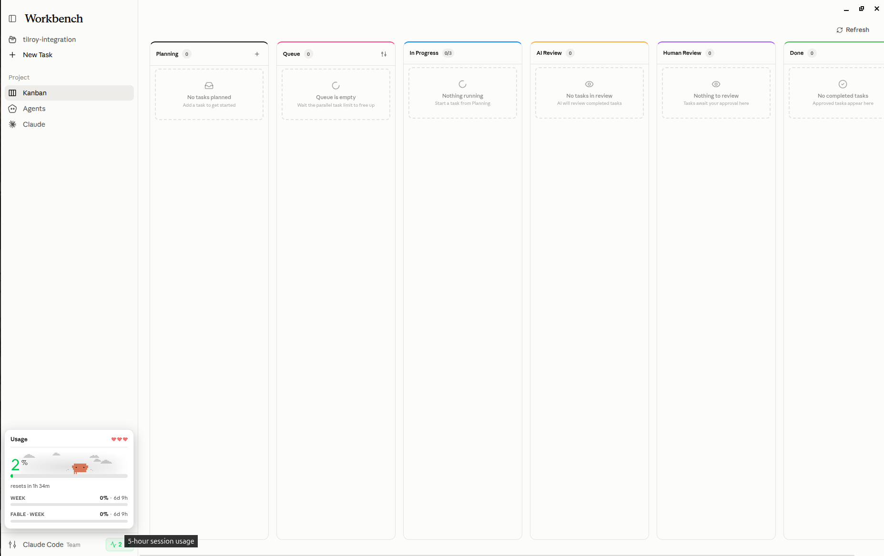

<p align="center">
  <picture class="github-only">
    <source media="(prefers-color-scheme: light)" srcset="./resources/assets/workbench-light.png">
    <source media="(prefers-color-scheme: dark)" srcset="./resources/assets/workbench-dark.png">
    
  </picture>
</p>

**Workbench is a desktop app based on the Claude Code harness, built for proactive engineers.** It gives you a space to manage your project tasks and hand each one to an agent that works in its own git worktree, so your main branch stays untouched until you review and merge. Every task starts with a short triage run that efficiently picks the model and the thinking effort based on the task description, and decides whether the work needs planning, so a one-line fix doesn't burn an Opus run and a refactor across a dozen files doesn't get handed to Haiku. From there, the same session plans, implements, runs your project's checks, reviews its own diff with fresh eyes, and commits, while parallel tasks are told which files the other unmerged branches touch so they stay out of each other's way.

<p align="center">
  
</p>

<p align="center">
  <picture class="github-only">
    <source media="(prefers-color-scheme: light)" srcset="./resources/assets/kanban-light.png">
    <source media="(prefers-color-scheme: dark)" srcset="./resources/assets/kanban-dark.png">
    
  </picture>
</p>

Workbench also improves over time by learning and retaining preferences from your sessions, enabling a built-in compounding engineering workflow. You become the manager/architect of your project, setting the direction and priorities while the agents do the work. Nothing lands until you have reviewed it, and you always know what the result costs.

<p align="center">
  <picture class="github-only">
    <source media="(prefers-color-scheme: light)" srcset="./resources/assets/graph-light.png">
    <source media="(prefers-color-scheme: dark)" srcset="./resources/assets/graph-dark.png">
    
  </picture>
</p>

## Motivation

Every creative builder has a graveyard of ideas. Each idea wants an evening you don't have, and the ones you start stall where the interesting part ends, and the plumbing begins. The agent in your terminal can do that plumbing today, but you still sit with it one session at a time: one idea, one branch, one window, until the context runs out. Workbench closes that gap by turning your ideas into projects and your projects into a board of tasks the agents build in parallel, so they end up in review instead of buried.

<p align="center">
  <picture class="github-only">
    <source media="(prefers-color-scheme: light)" srcset="./resources/assets/agents-light.png">
    <source media="(prefers-color-scheme: dark)" srcset="./resources/assets/agents-dark.png">
    
  </picture>
</p>

Most tools in this space write their own agent harness, and none of them outperforms the one you already have installed. You see it in the results: a loop that plans worse, retries more, and spends more than Claude Code does on the same task. So why build another harness when one already works? Workbench runs on Claude Code rather than competing with it, using the same CLI with your own accounts, subagents, skills, and MCP servers, and spending its own effort on everything around the session instead.

## Run on Linux

Requirements: Node.js 24 or newer, and the Claude Code CLI installed and logged in.

To run from a terminal during development:

```bash
npm install
npm run dev
```

To install it as a normal app that opens from the Ubuntu app menu:

```bash
bash scripts/build-deb.sh
```

The script builds the app, packages a `.deb` into `dist/`, and installs it with `apt`. It asks for your sudo password. Rerun it after each code change, because the installed app doesn't reload from the source folder.

## Contribute

Pull requests are temporarily not accepted, but every other kind of contribution is welcome. If something looks broken or missing, open an [issue](https://github.com/proactive-agent/workbench/issues) describing what you expected to happen instead. Ideas, questions, and features you would like to see belong in [discussions](https://github.com/proactive-agent/workbench/discussions), where they can be argued over before implementation.

## License

Copyright (C) 2026 Artyom Vancyan. [MIT](./LICENSE)
